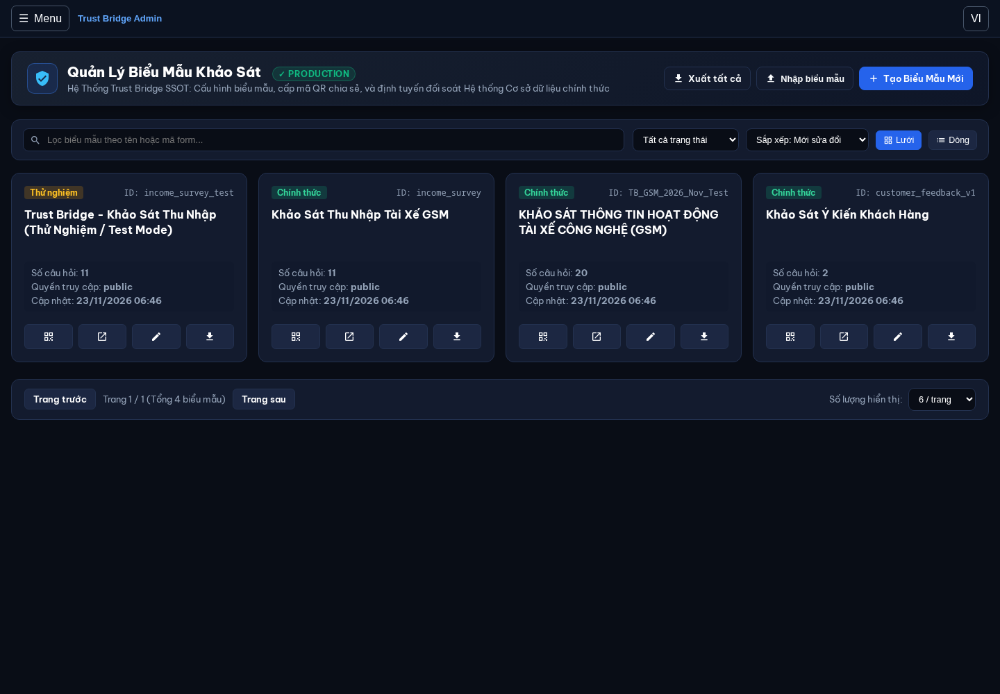
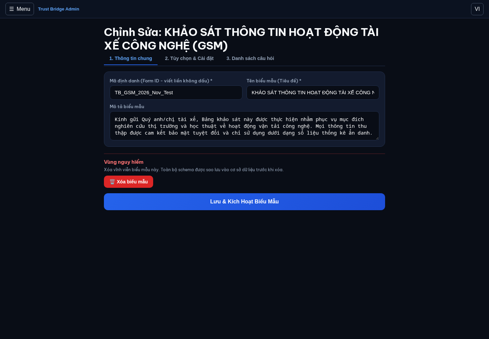
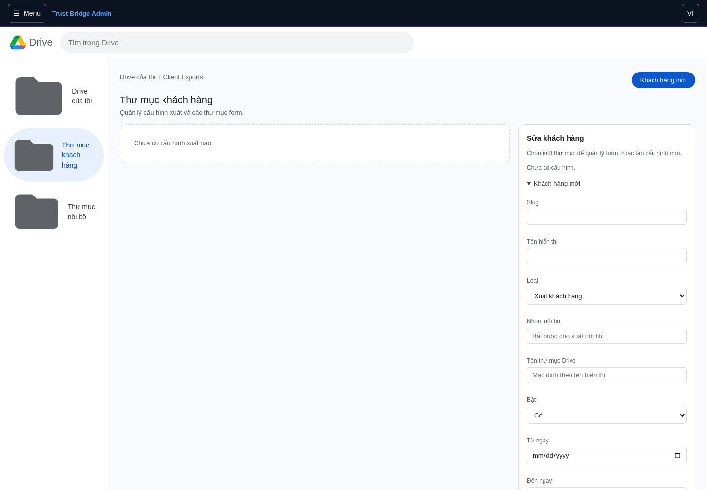
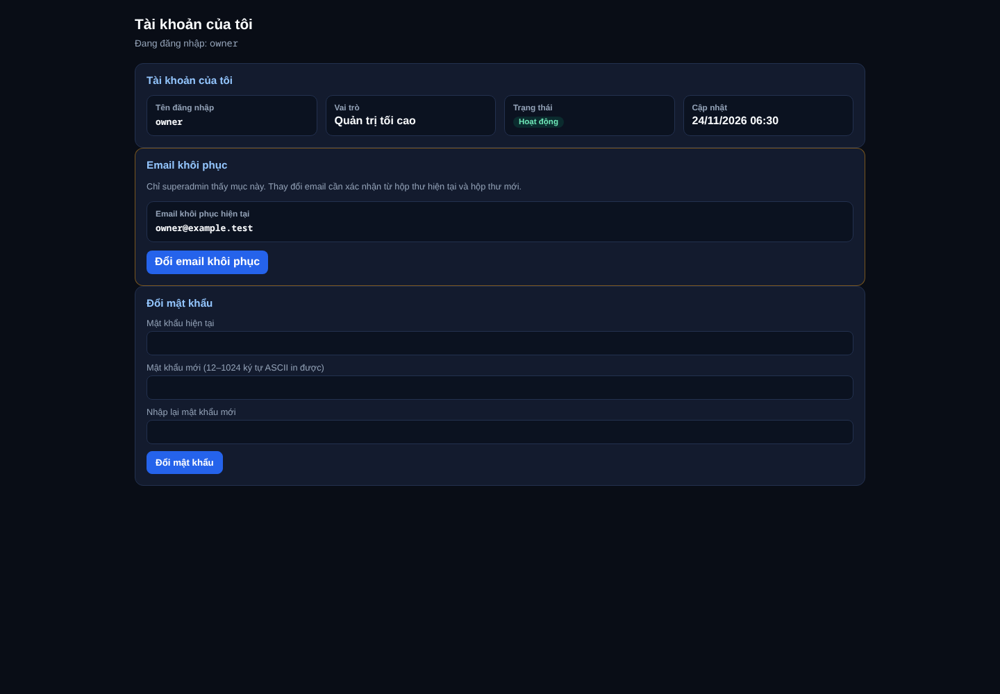

# Hướng dẫn quản trị Trust Bridge

Tài liệu dành cho quản trị viên vận hành hệ thống Trust Bridge: quản lý biểu mẫu, module kiểm tra, xuất Google Drive và tài khoản quản trị.

Ảnh chụp trong tài liệu lấy từ môi trường staging. Tên biểu mẫu, thư mục và tài khoản trong ảnh chỉ là dữ liệu minh họa.

## 1. Truy cập và đăng nhập

Mở miền quản trị đã được cấp, ví dụ:

```text
https://admin.trustbridgevn.com
```

Hệ thống dùng trang đăng nhập riêng, không còn hộp thoại Basic Auth của trình duyệt.


Nhập:

- Tên đăng nhập: tài khoản quản trị đã được cấp
- Mật khẩu: mật khẩu của tài khoản đó

Phiên đăng nhập được giữ bằng cookie `HttpOnly`, có thời hạn 12 giờ. Tài khoản được xác thực từ cơ sở dữ liệu, không dùng mật khẩu môi trường. Tài khoản bị tắt, bị xóa, đổi mật khẩu hoặc không tồn tại sẽ không đăng nhập được.

Bấm **Đăng xuất** trên thanh điều hướng để kết thúc phiên.

### Vai trò

| Vai trò | Quyền chính |
|---|---|
| `superadmin` (**Quản trị**) | Toàn bộ quản trị, gồm quản lý tài khoản, phân quyền, thùng rác, email khôi phục |
| `manager` | Biểu mẫu, dữ liệu nộp, audit, media, CTV, ảnh/object, module, exports |
| `reviewer` | Dữ liệu nộp và các màn hình được phép xem |
| `viewer` | Chỉ xem các màn hình được phép |

Thanh điều hướng có nút `VI/EN` để đổi ngôn ngữ giao diện. Ngôn ngữ mặc định là tiếng Việt và được ghi nhớ trên trình duyệt.

## 2. Tổng quan menu

Menu trên cùng bên trái gồm:

- **Biểu mẫu**: danh sách và trình chỉnh sửa biểu mẫu
- **Dữ liệu nộp**: xem, lọc và xuất dữ liệu bài nộp
- **Audit**: nhật ký kiểm toán
- **Media**: quản lý ảnh và tệp tĩnh
- **CTV**: danh bạ cộng tác viên, thêm/sửa/tạm tắt/xóa, bài nộp và quota
- **Ảnh/Object**: định nghĩa object ảnh và engine đang có
- **Module**: logic, object và engine module trong cơ sở dữ liệu
- **Exports**: cấu hình xuất Google Drive
- **Tài khoản của tôi**: xem vai trò, trạng thái, email khôi phục (superadmin) và đổi mật khẩu
- **Quản lý tài khoản**: chỉ superadmin
- **Thùng rác**: khôi phục biểu mẫu và bài nộp đã xóa
- **Email khôi phục**: chỉ superadmin

## 3. Quản lý biểu mẫu

### 3.1 Danh sách biểu mẫu

Mở **Biểu mẫu**.



Các thao tác chính:

- **Tạo Biểu Mẫu Mới**: tạo biểu mẫu mới.
- **Nhập biểu mẫu**: nhập một form hoặc một gói nhiều form.
- **Xuất tất cả**: tải toàn bộ biểu mẫu dưới dạng JSON.
- Ô tìm kiếm: lọc theo tên hoặc mã form.
- Bộ lọc trạng thái và kiểu sắp xếp.
- Nút trên từng thẻ:
  - QR: mở mã QR và liên kết chia sẻ
  - Mở: mở form công khai
  - Bút chì: mở trình chỉnh sửa
  - Tải xuống: xuất riêng biểu mẫu đó

### 3.2 Trình chỉnh sửa biểu mẫu

Mở biểu mẫu cần sửa bằng nút bút chì.



Trình chỉnh sửa có ba tab:

1. **Thông tin chung**: mã form, tiêu đề, mô tả, giới hạn phản hồi, chế độ test, CTV, thông báo Telegram.
2. **Tùy chọn & Cài đặt**: kiểm tra ảnh toàn form và danh sách module.
3. **Danh sách câu hỏi**: thêm, sửa, sắp xếp câu hỏi, điều kiện hiển thị, chữ ký, consent gate và slot ảnh.

Bấm **Lưu & Kích hoạt biểu mẫu** sau khi sửa. Nếu form đã tồn tại, thao tác lưu sẽ cập nhật file cấu hình và registry.

### 3.3 Module kiểm tra của biểu mẫu

Chuyển sang tab **Tùy chọn & Cài đặt**, kéo xuống mục **Modules**.


Cách thêm một kiểm tra:

1. Bấm **+ Thêm Module**.
2. Đặt tên module.
3. Chọn **Loại module**:
   - `Module logic`: chạy implementation logic đã đăng ký
   - `Engine kiểm tra`: chạy engine kiểm tra
   - `Tổng hợp (tất cả)`: gộp nhiều module phía trên
   - `Phân bố (thống kê đáp án)`: thống kê đáp án trên toàn bộ bài nộp
4. Chọn engine hoặc module tương ứng.
5. Chọn nguồn đầu vào:
   - Câu hỏi
   - Đầu ra của module trước
   - Toàn bộ module trước
   - Giá trị cố định
6. Bật **Từ chối bài gửi khi module không đạt** nếu đây là kiểm tra chặn.
7. Lưu biểu mẫu.

Các kiểm tra mặc định hiện dùng module, không còn `ValidationRule` trên từng câu hỏi:

- `phone_format`: engine `regex`, trường `driver_phone`, chấp nhận `0` + 9 chữ số hoặc `+84` + 9 chữ số.
- `daily_trips_range`: engine `number_range`, trường `cau_12`, giới hạn 1 đến 200.

Nếu module không đạt và có `reject_on_false`, bài nộp bị từ chối với `reject_message`. Nếu module lỗi cấu hình, hệ thống ghi nhận lỗi module thay vì bỏ qua âm thầm.

## 4. Module và kiểm tra ảnh

### 4.1 Trang Module

Mở **Module**.


Trang này là nguồn cấu hình chính cho:

- **Module object**: định nghĩa object ảnh, prompt, trường cần trích xuất, engine binding.
- **Module logic**: implementation logic an toàn đã biên dịch trong ứng dụng.
- **Module engine**: các engine kiểm tra như `regex`, `number_range`, `required_fields`, `date_range`, `arithmetic`.

Có thể tìm kiếm, mở rộng từng module, bật/tắt, sửa hoặc xóa. Việc xóa engine đang được object đang bật sử dụng sẽ bị chặn.

### 4.2 Trang Ảnh/Object

Mở **Ảnh/Object**.


Trang này dùng để:

- Tạo object ảnh mới.
- Xem và sửa prompt, extractor, classify role, trường dự kiến, engine binding của object.
- Xem danh sách engine hiện có.

Lưu ý phân biệt:

- **Object** là định nghĩa cách đọc một loại ảnh.
- **Engine** là logic kiểm tra dùng chung.
- Object chỉ **tham chiếu** engine bằng ID; định nghĩa engine nằm trong trang **Module**.
- Danh sách engine trong trang Ảnh/Object là danh mục chỉ đọc để biết object có thể gắn engine nào. Muốn sửa engine, vào **Module**.

## 5. Xuất Google Drive

Mở **Exports**.

### 5.1 Drive của tôi


Màn hình gốc có hai thư mục:

- **clients**: cấu hình xuất cho khách hàng
- **internal**: cấu hình xuất nội bộ

Panel bên phải dùng để:

- Đổi tên thư mục Drive.
- Chạy xuất thủ công bằng **Chạy xuất**.
- Xem báo cáo xuất gần nhất.

### 5.2 Sửa khách hàng

Mở thư mục **clients**.



Tại đây:

- Danh sách folder khách hàng hiện có.
- Panel **Sửa khách hàng** để tạo cấu hình mới.
- Bấm vào một folder khách hàng để mở cấu hình của khách đó.

### 5.3 Quản lý form của khách hàng

Trong folder khách hàng:

- Các form khách hàng nhận được hiển thị thành các file card.
- Panel bên phải **Quản lý form của khách hàng này** dùng để:
  - chọn form khách hàng nhận
  - chỉnh trường mặc định
  - trạng thái
  - loại xe
  - khoảng ngày
  - ảnh đính kèm
  - xóa cấu hình khách hàng

Bấm vào một form card để mở cấu hình form đó.

### 5.4 Quyền truy cập của khách hàng trong form

Trong folder form:

- Chọn **Trường dữ liệu** được xuất.
- Chọn **Trạng thái** được xuất.
- Chọn **Loại xe**.
- Chọn chế độ ngày:
  - Kế thừa khoảng của khách hàng
  - Không giới hạn
  - Ngày tùy chỉnh
- Bật/tắt ảnh bài nộp.
- Bấm **Lưu đầu ra form**.
- Nếu form có override, có thể **Đặt lại mặc định khách hàng**.

### 5.5 Chạy xuất

Từ màn hình gốc của Exports, bấm **Chạy xuất**. Yêu cầu trả về ngay và tiến trình chạy nền. Thẻ **Tiến trình xuất Drive** hiển thị trạng thái, số khách hàng, form, dòng, sheet và ảnh đang xử lý; trang tự làm mới khi xong. Hệ thống dùng khóa tư vấn trong cơ sở dữ liệu để tránh hai lần xuất chạy chồng nhau. Xem kết quả cuối ở **Báo cáo xuất gần nhất**.

## 6. Tài khoản và phân quyền

### 6.1 Tài khoản của tôi

Mở **Tài khoản của tôi**.



Trang này hiển thị:

- Tên đăng nhập
- Vai trò hiện tại
- Trạng thái tài khoản
- Thời điểm cập nhật
- Email khôi phục, chỉ với superadmin
- Form đổi mật khẩu

Superadmin thấy thêm khối **Email khôi phục** và nút **Đổi email khôi phục**. Việc đổi email đi qua trang xác nhận riêng, cần truy cập cả hộp thư hiện tại và hộp thư mới. Các vai trò khác không thấy email này trong HTML.

Đổi mật khẩu cần nhập mật khẩu hiện tại, mật khẩu mới và xác nhận. Mật khẩu mới phải dài 12 đến 1024 ký tự ASCII in được.

### 6.2 Quản lý tài khoản

Chỉ superadmin thấy mục **Quản lý tài khoản**. Trang này có:

- **Tạo tài khoản quản trị**
- **Phân quyền tài khoản**: chọn tài khoản và vai trò mới
- Bảng tài khoản với nút **Quản lý** cho từng tài khoản
- **Thùng rác tài khoản**: khôi phục trong vòng 30 ngày

Quy tắc an toàn:

- Không thể tự tắt, tự xóa hoặc tự hạ vai trò của mình.
- Phải giữ ít nhất một superadmin đang hoạt động.
- Tài khoản đã xóa không đăng nhập được.
- Mật khẩu của tài khoản khác không được đặt hộ; mỗi người tự đổi qua **Tài khoản của tôi**.

## 7. Các màn hình vận hành khác

- **Dữ liệu nộp**: xem và lọc bài nộp, xuất CSV/JSON. Không chia sẻ ảnh chụp màn hình có số điện thoại hoặc thông tin tài xế.
- **Audit**: nhật ký kiểm toán, phục vụ truy vết thay đổi.
- **Media**: quản lý tệp tĩnh và ảnh minh họa.
- **CTV**: danh bạ cộng tác viên, thêm/sửa/tạm tắt/xóa, bài nộp và quota.
- **Thùng rác**: khôi phục biểu mẫu hoặc bài nộp đã xóa. Không xóa vĩnh viễn nếu chưa có phê duyệt.

## 8. Checklist nhanh sau khi cấu hình

- [ ] Biểu mẫu đã lưu và kích hoạt.
- [ ] Module kiểm tra có `reject_on_false` đúng chỗ.
- [ ] Điện thoại được kiểm tra bằng `phone_format` với `0` + 9 hoặc `+84` + 9.
- [ ] Số chuyến nằm trong khoảng cho phép.
- [ ] Object ảnh tham chiếu engine đang bật.
- [ ] Exports chỉ gửi đúng form, đúng trạng thái, đúng trường.
- [ ] Chạy thử export và kiểm tra báo cáo gần nhất.
- [ ] Tài khoản có đúng vai trò.
- [ ] Không đưa ảnh chụp có dữ liệu cá nhân vào tài liệu hoặc chat.

## 9. Xử lý sự cố nhanh

| Hiện tượng | Kiểm tra |
|---|---|
| Không đăng nhập được | Tài khoản còn hoạt động không, mật khẩu đúng không, tài khoản có bị xóa không |
| Không thấy menu Quản lý tài khoản | Tài khoản không phải superadmin |
| Form không nhận module | Module có được bật không, engine có tồn tại và đang bật không, input có đúng tên không |
| Bài nộp bị từ chối bởi module | Xem `reject_message`, kiểm tra giá trị thực tế và cấu hình module |
| Export không chạy | Kiểm tra cấu hình khách hàng, form được chọn, trạng thái/trường, báo cáo lỗi gần nhất |
| Object báo thiếu engine | Engine bị xóa hoặc bị tắt; bật lại trong **Module** hoặc sửa binding của object |
| Đổi ngôn ngữ không đổi nội dung | Nút `VI/EN` đổi ngôn ngữ thanh điều hướng và các màn hình đã có bản dịch; tải lại trang nếu cần |
