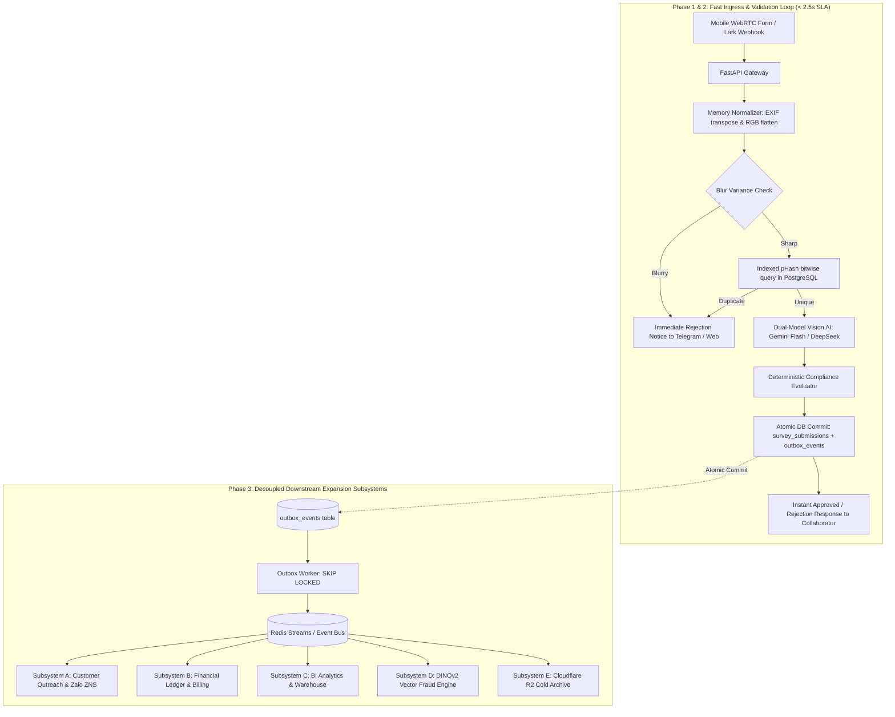
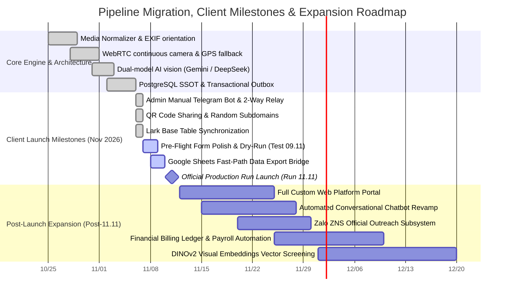
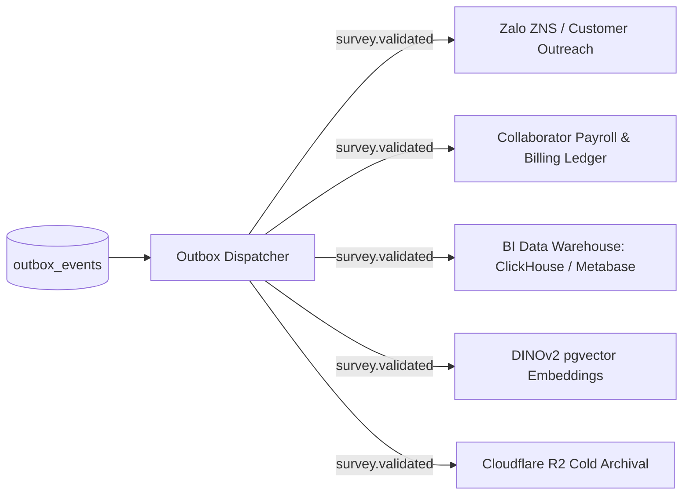
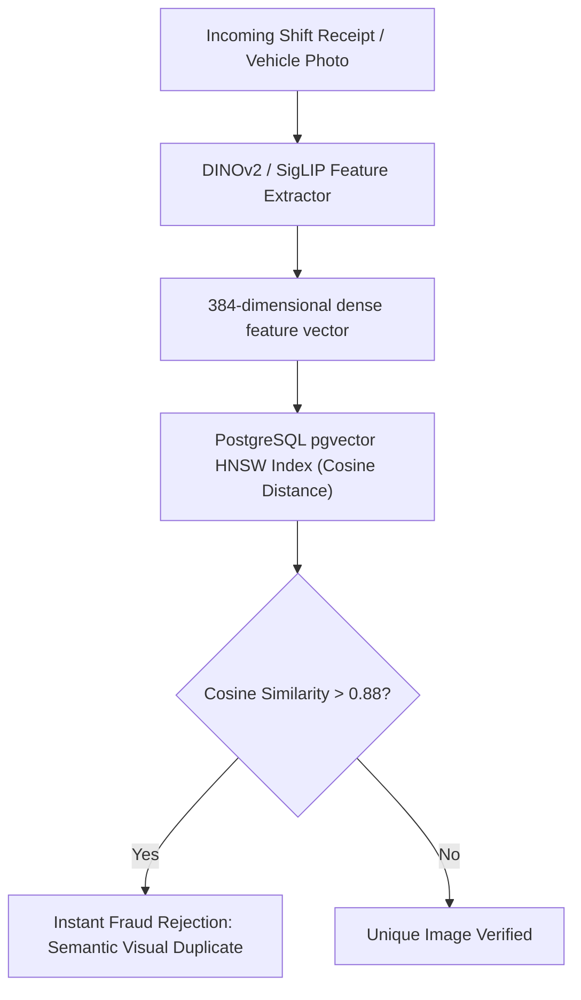

# Survey Verification Pipeline: Master Execution, Migration & Expansion Roadmap Plan

**Document Classification:** Authoritative Strategic Roadmap, Rollout Battle Plan & Operational Expansion Plan  
**System Baseline:** Survey Verification Pipeline v3.0.0  
**Target Infrastructure:** DigitalOcean SGP1 (Singapore) + Cloudflare R2 + PostgreSQL (pgvector) + Redis  
**Nominal Service Level Agreement (SLA):** Synchronous review loop < 2,500 ms (p50), < 3,800 ms (p99)  
**Target Throughput Scale:** 2,000 -> 20,000 -> 50,000+ daily submissions  

---

## 1. Executive Summary & Evolution Plan

### 1.1 The Architecture Problem Statement
The original field survey verification system operated on an un-orchestrated chain of Google Forms, ByteDance Lark Base (Bitable) forms, and an n8n automation engine. In field testing across VinFast / GSM / Xanh SM electric bike and car drivers in Vietnam, this legacy architecture experienced critical failure modes:
1. **Severe Latency Bottlenecks (30s – 2m):** n8n processed large multi-megabyte mobile photos sequentially as in-memory base64 strings in Node.js, choking event loops and garbage collection.
2. **Synchronous Coupling:** Immediate collaborator responses were blocked by downstream side-effects (uploading full-res photos to Google Drive, appending to spreadsheets, and issuing accounting entries).
3. **ByteDance Lark Base Attachment Friction:** Ephemeral `tenant_access_token` requirements and non-static CDN redirect URLs introduced multiple round-trips before reading a single image byte.
4. **Client-Side Failure Modes:** Unhandled EXIF orientation flags flipped receipts sideways, while RGBA/CMYK color profile mismatches crashed image libraries during JPG/PNG conversions.

### 1.2 Core Architectural Mandate
The restructured pipeline enforces strict **SLA isolation**:
- **Synchronous Ingress Path (< 2.5s SLA):** Executes exclusively memory-buffered media normalization, fast Laplacian blur pre-filtering, 64-bit indexed perceptual hash duplicate detection, driver vehicle binding verification, and dual-model AI vision transcription.
- **Asynchronous Transactional Outbox:** All heavy downstream tasks (customer messaging, financial accounting ledgers, collaborator payroll, analytics data warehouse streaming, and cold storage archival) are completely decoupled via PostgreSQL `outbox_events` and Redis event queues.



---

## 2. The 3-Phase Execution Battle Plan & Status Audit



### 2.1 Critical Client Milestones (November 2026 Alignment)
Following direct directive and timeline alignment with leadership on 2026-11-07, priorities are calibrated around a two-stage field delivery:
1. **Pre-Flight System Test (Target: 2026-11-09 / 09.11):**
   - Complete polish and locking of dynamic survey forms (`/forms/income_survey`).
   - Verify end-to-end QR code generation, random subdomain routing, camera capture quality on real mobile browsers, and bilingual Vietnamese/English strings.
   - Execute rehearsal across simulated and real GSM driver input submissions.
2. **Official Live Production Run (Target: 2026-11-11 / 11.11):**
   - Production cutover and live data collection deployment across the full collaborator fleet.

### 2.2 Architectural Scope Calibration
To guarantee uncompromised reliability for the 11.11 live run, non-critical automations are cleanly staged:
* **Telegram Operations -> Admin Manual Moderation Prioritized (COMPLETED & ACTIVE):**
  - The Telegram dual-bot network (`@TrustBridgeVNAdmin_Bot` and `@TrustBridgeVN_bot`) operates with human supervisor oversight in the Admin Moderation Group (`-5445563473`).
  - Features active: 2-way live relay chat between admins and requesters, 1-click dossier inspection, 1-tap manual review decisions, request locking, cancellation (`/cancel`), and 5/2h rolling rate limits.
  - *Automated Chatbot Revamp* (conversational auto-agent dialogue tree) is deferred post-11.11 launch as confirmed by client directive (*"luồng revamp auto ko kịp mình để sau (aka Admin manual done)"*).
* **Customer Deliverable -> Google Sheets Fast-Path Bridge Prioritized:**
  - Client mandate: *"Đổ tạm data về google sheet cho khách hàng (luồng web platform mình xây từ từ cho chuẩn chỉnh sau)..để ra số đc"*.
  - Instead of holding customer deliverables waiting for a complex full-scale custom web portal, the system streams verified survey data directly to **Google Sheets**.
  - This ensures external stakeholders immediately receive clean daily numbers, while the permanent web platform is built out systematically post-launch.
* **Resource Procurement Open Channel:**
  - Client support: *"em cần gì thì cứ nói anh nha ^_^ mua gì thì để anh mua cho"*.
  - Requisite external resources flagged: Google Cloud Service Account credentials (for Google Sheets API access) and custom domain DNS records.

### 2.3 Phase 1 & 2 Completed Status: Ingress, Verification & Security
- **Media Normalization:** Raw multipart uploads stream into memory buffer (`io.BytesIO()`); zero disk contention; EXIF auto-rotation; RGBA/CMYK flattened to white RGB canvas.
- **Fast Quality Gates:** Laplacian blur pre-check rejects unreadable receipts in `< 25ms`; BIT(64) Hamming distance queries detect duplicates in `< 15ms`.
- **Dual-Model AI Vision:** Primary DeepSeek Flash / Gemini 3.5 Flash transcription with deterministic Python compliance evaluator; zero prompt injection exposure.
- **Dual Telegram Bots & Lark Base Sync:** `@TrustBridgeVNAdmin_Bot` (Admin group `-5445563473`) + `@TrustBridgeVN_bot` (Driver DM) live on DigitalOcean; automated row writes into Lark Base (`UwVabU53laZe5OsKgEGjy7QRpOh` / `tblTpiVhUtY98Zc8`).
- **Request Hardening:** Active request locking, `/cancel` support, and 5 requests per 2-hour rolling rate limits active.

## 3. Downstream Expansion Plan



### 3.1 Subsystem A: Customer Operations & Automated Outreach
Once a survey is validated (`status = 'APPROVED'`), customer-facing delivery workflows execute asynchronously without delaying the collaborator.

#### Implementation Blueprint
1. **Event Payload (`survey.validated`):**
   ```json
   {
     "event_id": "evt_9f82c401-1a3b-489e-9730-104928173491",
     "event_type": "survey.validated",
     "timestamp": "2026-11-06T10:15:30Z",
     "payload": {
       "submission_id": "sub_4091823",
       "driver_tag": "DRV-A7F92B10",
       "survey_type": "GSM_INCOME_VERIFIED",
       "customer_id": "cust_882190",
       "verified_metrics": {
         "gross_revenue": 1650000,
         "net_income": 1250000,
         "total_trips": 18,
         "vehicle_type": "CAR",
         "license_plate_masked": "29E-***.45"
       }
     }
   }
   ```
2. **Delivery Channels:**
   - **Zalo Notification Service (ZNS):** Sends an official branded template message to the driver/customer acknowledging the validated session and verified shift metrics.
   - **Customer Portal / Google Drive Clean Append:** Automatically outputs sanitized records to client delivery spreadsheets (`YYYY-MM-DD_Deliverables.xlsx`), completely stripping raw AI tokens, collaborator payout rates, and internal diagnostic flags.

### 3.2 Subsystem B: Financial Ledger, Billing & Collaborator Payroll
Automates collaborator earnings, customer billing line items, and invoice generation with atomic double-entry bookkeeping.

#### Database Schema (`schema.sql` expansion)
```sql
-- Collaborator Compensation Ledger
CREATE TABLE IF NOT EXISTS collaborator_payout_ledger (
    id UUID PRIMARY KEY DEFAULT gen_random_uuid(),
    collaborator_id VARCHAR(64) NOT NULL,
    submission_id VARCHAR(64) NOT NULL UNIQUE,
    amount_vnd INTEGER NOT NULL,
    currency VARCHAR(10) NOT NULL DEFAULT 'VND',
    status VARCHAR(32) NOT NULL DEFAULT 'PENDING', -- PENDING, CLEARED, PAID, CLAWBACK
    created_at TIMESTAMP WITH TIME ZONE DEFAULT NOW(),
    cleared_at TIMESTAMP WITH TIME ZONE
);
CREATE INDEX idx_payout_collab_status ON collaborator_payout_ledger(collaborator_id, status);

-- Customer Invoicing & Billing Ledger
CREATE TABLE IF NOT EXISTS customer_billing_ledger (
    id UUID PRIMARY KEY DEFAULT gen_random_uuid(),
    customer_id VARCHAR(64) NOT NULL,
    submission_id VARCHAR(64) NOT NULL UNIQUE,
    billable_unit_vnd INTEGER NOT NULL,
    tax_vat_vnd INTEGER NOT NULL,
    total_amount_vnd INTEGER NOT NULL,
    invoice_id VARCHAR(64),
    status VARCHAR(32) NOT NULL DEFAULT 'UNBILLED', -- UNBILLED, INVOICED, SETTLED
    created_at TIMESTAMP WITH TIME ZONE DEFAULT NOW()
);
CREATE INDEX idx_billing_cust_status ON customer_billing_ledger(customer_id, status);
```

#### Operational Rules
- **Idempotency:** A strict unique constraint on `submission_id` ensures that even under network retries or outbox worker restarts, no collaborator or customer is ever credited or billed twice.
- **Clawback Protocol:** If a supervisor or automated audit flags fraud post-approval, the ledger issues a negative compensation entry (`status = 'CLAWBACK'`), balancing future payouts automatically.

### 3.3 Subsystem C: Reporting & BI Data Warehouse Architecture
Provides operational transparency, live fraud monitoring, and financial dashboards.

#### Key Metrics & Real-Time KPIs
1. **Latency & SLA Metrics:**
   - Synchronous loop latency (p50, p90, p99).
   - Component latency breakdown (media normalization vs AI vision vs DB commit).
2. **Quality & Compliance Yield:**
   - First-pass approval yield (target > 85%).
   - Rejection breakdown by category (`BLURRY`, `ARITHMETIC_MISMATCH`, `DUPLICATE_REUSE`, `VEHICLE_MISMATCH`).
3. **Operational Volumes:**
   - Submissions per hour by region (Hanoi, HCMC, Da Nang).
   - Vehicle fleet distribution (VinFast VF e34, VF 5, VF 8, Feliz, Klara).
4. **Fraud & Forensic Telemetry:**
   - Duplicate image reuse attempts blocked per day.
   - Screen recapture detection rates.

#### Technology Stack
- **Ingestion:** Redis Streams fan-out to ClickHouse / PostgreSQL analytics tables.
- **Visualization:** Direct read-only connection to Metabase / Looker Studio for operations leaders.

### 3.4 Subsystem D: Next-Generation Anti-Fraud Roadmap (Deep Learning Embeddings)
Upgrading from 64-bit dHash perceptual hashing to deep semantic vector embeddings.



#### Technical Plan
1. **Model:** Quantized ONNX runtime of Meta's `dinov2_vits14` (80MB model size, running on CPU in `< 45ms`).
2. **Vector Index:** PostgreSQL `pgvector` with HNSW indexing:
   ```sql
   ALTER TABLE survey_embeddings ADD COLUMN embedding vector(384);
   CREATE INDEX idx_survey_embeddings_hnsw ON survey_embeddings 
   USING hnsw (embedding vector_cosine_ops) WITH (m = 16, ef_construction = 64);
   ```
3. **Defensive Capability:** Detects cropped, color-altered, tilted, or brightness-adjusted duplicate photos that evade classical DCT/dHash hashes.

### 3.5 Subsystem E: Cold Storage Archival & Lifecycle Management
- **Hot Tier (Memory & Redis):** Temporary in-memory processing during validation (< 3 seconds).
- **Warm Tier (PostgreSQL & Local NVMe):** Master records, audit logs, and downscaled 768px WebP images (retained 90 days for operational audits).
- **Cold Tier (Cloudflare R2):** Unmodified source images uploaded in the background with zero-egress pricing. Lifecycle rules transition objects to Glacier-equivalent cold storage after 180 days, maintaining compliance with Vietnam Decree 13.

---

## 4. Capacity Scaling Milestones & Infrastructure Roadmap

| Milestone | Daily Throughput | Monthly Volume | Server Configuration | Monthly Infrastructure Cost | Primary Scaling Action |
|---|---|---|---|---|---|
| **Stage 1 (Baseline)** | 2,000 surveys/day | 60,000 | 1 Droplet (2 vCPU, 4GB RAM) | ~$24.00 / month | Single Docker Compose host (Caddy + FastAPI + PG + Redis). |
| **Stage 2 (Scale Target)** | 20,000 surveys/day | 600,000 | 1 Droplet (4 vCPU, 8GB RAM) | ~$83.00 - $93.00 / month | Worker decoupling, PgBouncer connection pooling, Redis caching. |
| **Stage 3 (Enterprise Fleet)** | 50,000+ surveys/day | 1,500,000+ | Cluster (App + Managed DB + Managed Redis) | ~$220.00 - $280.00 / month | Read-replica database scaling, multi-container horizontal worker swarm. |

---

## 5. Risk Management, SLA Guarantees & Disaster Recovery Plan

### 5.1 Primary AI Provider Outage Contingency
- **Risk:** Google AI Studio Gemini API rate limit or regional outage.
- **Contingency:** Automatic failover to DeepSeek structured vision API within a hard **4.0-second timeout boundary**. If both external providers fail, the system falls back to manual review queuing (`status = 'MANUAL_REVIEW'`), notifying the collaborator that the submission is received and queued without dropping the session.

### 5.2 Network & DNS Resilience
- **Risk:** Domestic Vietnamese ISP DNS throttling on external Google APIs.
- **Contingency:** Client-side 15s timeout with automatic fallback to Singapore edge IP geolocation (`GET /api/v1/geo/ip-fallback`), guaranteeing location acquisition within 30ms.

### 5.3 Point-In-Time Database Recovery (PITR)
- **Backup Frequency:** Automated daily PostgreSQL pg_dump exports synced to encrypted remote object storage.
- **Write-Ahead Logging (WAL):** Continuous WAL archiving allowing recovery to within 60 seconds of any hardware failure.
- **Rollback Runbook:** Clean containerized blue/green deployments enable instant version rollbacks via `git checkout <tag> && docker compose up -d --build app`.

---

*Document compiled and ratified by Principal Systems Architect. Baseline active in repository docs.*
