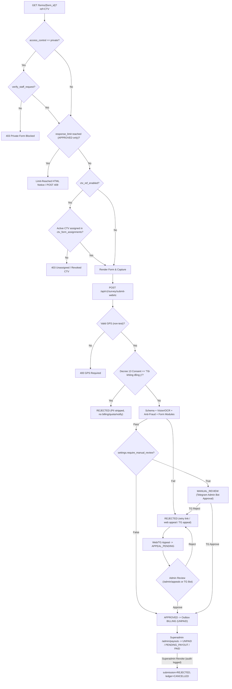

# Trust Bridge Survey Pipeline - Technical Architecture & LLM Reference

> **Purpose**: Authoritative current technical reference for engineers, operators, and LLM assistants guiding clients on the Trust Bridge Survey Verification Pipeline (`/home/ebylxn/projects/survey-pipeline`). Every route, table, role check, trigger, and error response documented here reflects the current codebase.

---

## 1. System Topology & Package Layout

The application is a **modular monolith** built on FastAPI + PostgreSQL (with `pgvector` + `uuid-ossp`) + Redis + Telegram Bot API + Google Drive/Sheets APIs + optional R2/Lark integrations.

```text
survey-pipeline/
├── main.py                       # App construction, middleware (theme/nav/i18n injection), router mounting
├── config.py                     # Pydantic settings (env vars, feature flags, bot tokens, limits)
├── schema.sql                    # Fresh-install PostgreSQL schema mirror
├── scripts/
│   ├── migrations/001..017*.sql  # Versioned, checksum-chained transactional SQL migrations
│   ├── apply_migration.sh        # Guarded test-only migration runner (disposable *_test DBs only)
│   ├── deploy_prod.sh            # Guarded immutable-code release + migration + rollback script
│   └── smoke_prod.sh             # Post-deploy health, migration ledger, and HTTP smoke verification
├── core/
│   ├── server.py                 # Entrypoint resolving exact FORWARDED_ALLOW_IPS peers (e.g. caddy)
│   ├── state.py                  # DB/Redis pools, FORM_REGISTRY, admin RBAC (_admin_roles_for_path), verify_staff_request
│   ├── admin_accounts.py         # Staff accounts CRUD, last-superadmin protection, 30-day soft-delete bin
│   ├── admin_recovery.py         # Superadmin recovery email OTP verification
│   ├── ctv.py                    # CTV directory SSOT, normalization, ctv_form_assignments, default auto-assign
│   ├── ctv_onboarding.py         # Bot invitations, own-contact binding, same-number rebind, billing lineage, multi-role trigger
│   ├── ctv_auth.py               # CTV Telegram OTP login, Redis single-use challenges, auth_revision validation
│   ├── quotas.py                 # APPROVED-only CTV tracking goals & campaign response_limit helpers
│   ├── phone_links.py            # Standalone phone_telegram_links ownership boundary
│   ├── durable_work.py           # Outbox v2 intent enqueueing, recipient resolution, transition_submission
│   ├── outbox_delivery.py        # Token-fenced outbox claims, leases, billing execution, binding guards
│   ├── drive_exports.py          # Master image deduplication, client/internal Sheets, Drive shortcuts, pruning
│   ├── trash.py                  # Recoverable form/submission soft-delete snapshots
│   └── schema_gate.py            # Startup /readiness migration checksum gates
├── routers/
│   ├── survey.py                 # /forms/{form_id}, /camera-form, /api/v1/forms*, /api/v1/survey/* (pre-check, submit, appeal, status)
│   ├── ctv_login.py              # /ctv/login, /ctv/login/request, /ctv/login/verify, /ctv/logout
│   ├── ctv_portal.py             # /ctv authenticated dashboard (profile, goals, assigned surveys)
│   ├── login.py                  # Staff /login and /logout (30-day HttpOnly signed cookies)
│   ├── admin_forms.py            # /admin/forms, form editor save (auto-assigns non-test CTVs on brand-new forms)
│   ├── admin_ctvs.py             # /admin/ctvs CRUD, inline edit, /admin/ctvs/{code}/assignments, link/QR generator
│   ├── admin_appeals.py          # /admin/appeals queue, /approve, /reject (audit-logged)
│   ├── admin_payouts.py          # /admin/payouts superadmin-only settlement status & APPROVED/PAID revocation (audit-logged)
│   ├── admin_data.py             # /admin/submissions, photo serving, CSV/JSON export
│   ├── admin_audit.py            # /admin/audit viewer (superadmin + manager)
│   ├── admin_exports.py          # /admin/exports Google Drive config & manual trigger
│   ├── admin_accounts.py         # /admin/accounts, /admin/account (superadmin account CRUD + self password)
│   ├── admin_recovery.py         # /admin/recovery (superadmin email OTP)
│   ├── admin_modules.py          # /admin/modules (logic, object, engine module registry)
│   ├── admin_image_objects.py    # /admin/image-objects
│   ├── admin_media.py            # /admin/media static/sample gallery
│   └── webhooks.py               # Telegram & Lark webhooks
├── services/
│   ├── form_engine.py            # FormSchema, FormSettings (access_control, response_limit, require_manual_review, ctv_ref_enabled)
│   ├── submission_pipeline.py    # Request-independent validation, AI vision/OCR, dHash/DINOv2 anti-fraud, modules, Decree 13 dissent guard
│   ├── telegram_polling.py       # Admin bot (moderation, /audit, /warn, support) & Driver/CTV bot (onboarding, /forms, /quota, /appeal)
│   ├── outbox_notifications.py   # Telegram/Lark worker handlers
│   ├── outbox_exports.py         # R2/Drive worker handlers
│   └── audit_and_privacy.py      # record_audit_event -> system_audit_log
├── workers/
│   └── outbox_worker.py          # Background outbox v2 & periodic Drive sync worker
└── static/ui/                    # Unified dark-default theme (admin_theme.css), admin_nav.js, admin_i18n.js (VI/EN), form_editor.html, dynamic_form.html
```

---

## 2. Database Schema & Migration Chain (`001` -> `017`)

PostgreSQL is the **single source of truth**. Every migration is transactional, acquires `pg_advisory_xact_lock`, verifies the SHA-256 checksum of its predecessor in `schema_migrations`, and records its own checksum.

### 2.1 Core Tables

| Table | Primary Key | Purpose & Key Invariants |
|---|---|---|
| `authorized_users` | `telegram_user_id` (`BIGINT`) | Telegram identities & multi-role authority: `roles TEXT[] NOT NULL CHECK (cardinality(roles) >= 1 AND roles <@ ARRAY['COLLABORATOR','DRIVER','ADMIN']::text[])`, synced with legacy `role TEXT` by `sync_authorized_user_roles()` trigger. |
| `ctv_directory` | `code` (`TEXT`) | Authoritative CTV registry (`display_name`, `phone`, `telegram_user_id`, `is_active`, `bot_invite_token`, `auth_revision UUID`). `rotate_ctv_auth_revision()` trigger rotates `auth_revision` on changes to `code`, `phone`, `telegram_user_id`, or `is_active` (harmless `display_name`/`notes` edits do not rotate). |
| `ctv_bot_pending` | `telegram_user_id` (`BIGINT`) | Temporary invitation intent armed by `/start ctv_<token>`; never grants CTV authority until own-contact verification completes. |
| `ctv_form_assignments` | `(ctv_code, form_id)` | **Authorization table** controlling which CTVs may view, open, or submit a CTV-tracked survey (`ON DELETE CASCADE` from `ctv_directory`). Completely separate from `ctv_form_links` (referral-link/QR metadata). |
| `ctv_quotas` | `id` (`SERIAL`) | Tracking-only CTV goals (`scope_type IN ('form','tag','global')`, `max_submissions`, `period_days`). Counts `status = 'APPROVED'` only; never blocks submissions. |
| `phone_telegram_links` | `phone_normalized` (`TEXT`) | Standalone verified phone -> Telegram user mapping (`verified_contact`, `admin_verified`, or `conflicted`). Used for driver notifications and CTV rebind conflict detection. |
| `survey_submissions` | `id` (`UUID`), unique `submission_id` | Authoritative submission record (`form_id`, `ctv_code`, `collaborator_id`, `driver_phone`, `status IN ('APPROVED','REJECTED','APPEAL_PENDING','MANUAL_REVIEW')`, `form_data JSONB`, `media_manifest JSONB`, `work_owner`, `decision_version`). |
| `collaborator_billing_ledger` | `transaction_id` (`UUID`), unique `submission_id` | Per-submission CTV payout ledger (`collaborator_id`, `payout_amount_vnd`, `payout_status IN ('UNPAID','PENDING_PAYOUT','PAID','CANCELLED')`). |
| `admin_accounts` | `username` | Web staff accounts (`role IN ('superadmin','manager','reviewer','viewer')`, scrypt/bcrypt hash, `is_active`, `deleted_at`, `recovery_email` for `superadmin`). |
| `system_audit_log` | `id` | Append-only audit trail (`component_name`, `action`, `entity_type`, `entity_id`, `actor_type`, `actor_id`, `details JSONB`, `event_timestamp`). |
| `outbox_events` & `outbox_delivery_attempts` | `id` | Durable transactional outbox with token-fenced leases, deduplication `action_key`, and delivery receipts. |

### 2.2 Recent Key Migrations (`015` - `017`)

- **`015_ctv_auth_revision.sql`**: Adds `ctv_directory.auth_revision UUID` + `rotate_ctv_auth_revision()` trigger so revocations/identity edits immediately invalidate CTV browser sessions and pending OTPs.
- **`016_authorized_users_multi_roles.sql`**: Adds `authorized_users.roles TEXT[]`, backfills existing rows from `role`, enforces `authorized_users_roles_check`, and installs `sync_authorized_user_roles()` trigger (deduplicates in canonical priority `ADMIN > COLLABORATOR > DRIVER`; `TG_OP = 'INSERT' AND NEW.roles IS NULL` backfills from `role`; legacy `role`-only updates sync `roles`; explicit empty/NULL `roles` on `UPDATE` fail closed at constraints).
- **`017_ctv_form_assignments.sql`**: Creates `ctv_form_assignments` + `idx_ctv_form_assignments_form` and idempotently backfills all active non-test CTVs (`UPPER(code) NOT LIKE '%TEST%' AND UPPER(COALESCE(display_name,'')) NOT LIKE '%TEST%'`) onto `TB_GSM_2026_Nov_Test`.

---

## 3. Identity, RBAC & Multi-Role Rules

### 3.1 Web Staff Role Matrix (`core/state.py::_admin_roles_for_path`)

| Path / Capability | `superadmin` | `manager` | `reviewer` | `viewer` |
|---|:---:|:---:|:---:|:---:|
| `/admin/account`, `/admin/accounts/password` | RW | RW | RW | RW |
| `/admin/submissions`, `/admin/data`, submission photos | RW | RW | R | R |
| `/admin/appeals` (`GET` list / `POST` approve & reject) | RW | RW | RW | R (`403` on POST) |
| `/admin/audit`, `/api/v1/audit/*` | R | R | - | - |
| `/admin/forms`, `/admin/ctvs` (+ assignments), `/admin/media`, `/admin/image-objects`, `/admin/modules`, `/admin/exports` | RW | RW | - | - |
| `/admin/payouts`, `/admin/payouts/*/status`, `/admin/payouts/*/revoke` | RW | - | - | - |
| `/admin/accounts`, `/admin/recovery`, `/admin/trash`, `/api/v1/telegram/set-webhooks` | RW | - | - | - |
| `access_control = "private"` form preview & submit (`verify_staff_request`) | RW | RW | RW | RW |

### 3.2 Telegram Multi-Role Identity (`authorized_users.roles`)
- A Telegram user can hold any non-empty subset of `{'ADMIN', 'COLLABORATOR', 'DRIVER'}`.
- **Binding an `ADMIN` (or `DRIVER`) as a CTV**: `complete_ctv_onboarding` appends `'COLLABORATOR'` to `roles` while preserving `'ADMIN'`/`'DRIVER'` (and preserving `ADMIN` `username`/`full_name`). Administratively inactive incoming accounts (including inactive `ADMIN`s) are rejected (`ValueError`) both pre-check and via `RETURNING 1`.
- **Replacing a CTV account**:
  - If `old_user_id` held only `['COLLABORATOR']`: sets `is_active = FALSE`.
  - If `old_user_id` held multiple roles (e.g. `['ADMIN', 'COLLABORATOR']` or `['COLLABORATOR', 'DRIVER']`): removes `'COLLABORATOR'` from `roles`, keeps `is_active = TRUE` (preserving admin/driver privileges), and clears `username` if it matched the retired CTV code.
  - Records `CTV_TELEGRAM_REPLACED` in `system_audit_log` with `previous_telegram_user_id`, `telegram_user_id`, `previous_auth_revision`, and `auth_revision`.
- **Billing eligibility (`billing_collaborator_is_eligible`)**:
  - Directly eligible if `u.is_active AND 'COLLABORATOR' = ANY(u.roles)`.
  - Retired pre-rebind `collaborator_id` remains eligible for unpaid submissions **only** via a verified, acyclic, chronologically valid chain of `CTV_TELEGRAM_REPLACED` edges terminating at an active `ctv_directory` row whose current owner satisfies `is_active AND 'COLLABORATOR' = ANY(roles)`.

---

## 4. State Machines & Lifecycle Flows

### 4.1 Survey Submission, Verification, Appeal & Revocation Lifecycle



### 4.2 Recipient Resolution Boundary (`core/durable_work.py::_recipient`)
- `policy.source == "none"` -> `NOTIFICATIONS_DISABLED`.
- `policy.source == "question"` -> resolves normalized driver phone via `phone_telegram_links` (`updated_at <= created_at`, non-conflicted).
- `policy.source == "ctv"` -> **never confuses numeric `ctv_code` with `telegram_user_id`**:
  - When `ctv_code` is present, **always** queries active `ctv_directory` only (no fallback to `authorized_users`).
  - Only when `ctv_code` is empty does it validate `collaborator_id` as an ASCII positive 64-bit integer and query `authorized_users WHERE telegram_user_id = %s AND is_active AND 'COLLABORATOR' = ANY(roles)`.
- Before sending, `core/outbox_delivery.py::_binding_valid` re-verifies the live binding so queued verdicts never leak to a retired Telegram account.

---

## 5. Key HTTP Endpoints & Telegram Commands

### 5.1 Public / CTV Endpoints

| Endpoint | Auth | Behavior & Key Status Codes |
|---|---|---|
| `GET /` | Public | Default survey host redirects to `/ctv` (operator subdomains route to `/admin/*`). |
| `GET /ctv/login`, `POST /ctv/login/request`, `POST /ctv/login/verify`, `POST /ctv/logout` | Public -> CTV cookie | Code or phone -> 6-digit Telegram OTP (5 min TTL, 5 attempts, single-use in Redis) -> 30-day `HttpOnly` cookie bound to `auth_revision`. |
| `GET /ctv` | CTV session | Shows profile, `APPROVED`-only goals, and **assigned-only** open public forms. `303 -> /ctv/login` if invalid; `503` on DB outage (fail-closed). |
| `GET /forms/{form_id}`, `GET /camera-form` | Staff if `private`; assigned CTV if `ctv_ref_enabled` | `403` if private (unauth) or unassigned CTV; limit-reached HTML if `APPROVED` count >= `response_limit`; CTV selector dropdown lists assigned CTVs only. |
| `GET /api/v1/forms` | Public | Lists open public forms (excludes `private`). |
| `GET /api/v1/forms/{form_id}` | Staff if `private` | Returns schema JSON; `403` for unauthenticated access to `private` forms; `404` if missing. |
| `POST /api/v1/survey/pre-check` | Public (20/min/IP) | Instant blur/format/role check during camera capture. |
| `POST /api/v1/survey/submit-webrtc` | Staff if `private`; assigned CTV if `ctv_ref_enabled` | Enforces private staff auth (`403`), `APPROVED`-only `response_limit` (`409`), live CTV assignment (`403` immediately on mid-survey revoke), valid GPS on non-test (`400`), Decree 13 dissent guard (`REJECTED`), idempotency (`409` on conflict), pipeline & durable outbox. |
| `POST /api/v1/survey/appeal`, `POST /api/v1/survey/appeal/cancel` | Public (20/hr/phone) | Moves `REJECTED` submission to `APPEAL_PENDING` (or cancels back), visible on `/admin/appeals` and Telegram. |

### 5.2 Staff / Admin Endpoints (New & Core)

| Endpoint | Allowed Roles | Audit Event |
|---|---|---|
| `GET /admin/ctvs`, `POST /admin/ctvs`, `POST /admin/ctvs/{code}`, `POST /admin/ctvs/{code}/delete` | `superadmin`, `manager` | `CTV_CREATED`, `CTV_UPDATED`, `CTV_DELETED` (new non-test CTV auto-assigned open public forms) |
| `POST /admin/ctvs/{code}/assignments` | `superadmin`, `manager` | `CTV_ASSIGNMENTS_UPDATED` |
| `POST /api/v1/forms/upload-schema` / form editor save | `superadmin`, `manager` | `FORM_SAVED` (brand-new form auto-assigns active non-test CTVs; edits never clobber manual unassignments) |
| `GET /admin/appeals` | All staff (`viewer` read-only) | - |
| `POST /admin/appeals/{submission_id}/approve`, `.../reject` | `superadmin`, `manager`, `reviewer` | `APPEAL_APPROVED`, `APPEAL_REJECTED` (fires `transition_submission` outbox billing/Telegram verdicts) |
| `GET /admin/payouts` | `superadmin` only | - |
| `POST /admin/payouts/{submission_id}/status` | `superadmin` only | `PAYOUT_STATUS_CHANGED` (`UNPAID` / `PENDING_PAYOUT` / `PAID` / `CANCELLED`) |
| `POST /admin/payouts/{submission_id}/revoke` | `superadmin` only | `PAYOUT_REVOKED` (transitions submission to `REJECTED` and ledger row to `CANCELLED`, even if previously `PAID`) |
| `GET /admin/audit` | `superadmin`, `manager` | Read-only audit viewer |
| `GET/POST /admin/exports*` | `superadmin`, `manager` | `DRIVE_EXPORT_*` |
| `GET/POST /admin/accounts*`, `/admin/recovery*`, `/admin/trash*` | `superadmin` only | `ADMIN_ACCOUNT_*`, `TRASH_*` |

### 5.3 Telegram Bot Commands
- **CTV/Driver Bot**: `/start ctv_<token>` (arm invite), own-contact share (bind or same-number rebind), `/forms` (assigned-only open forms with `?ref=`), `/quota` (`APPROVED`-only), `📋 Khảo Sát Của Tôi` / `/history`, `/appeal <id>`, photo re-upload in chat, free-text support messages (Telegram-only).
- **Admin Bot**: Inline approve/reject on `MANUAL_REVIEW` (Telegram-only) & `APPEAL_PENDING` (interchangeable with `/admin/appeals`), `/audit <id>`, `/stats`, `/forms`, `/quota <ctv>`, `/warn <id>`, support ticket claim/reply/close.

---

## 6. LLM Troubleshooting & Error Lookup Table

When a user or operator reports an error, match the exact symptom/HTTP code below:

| Error / Symptom | HTTP / Reason | Exact Root Cause | Resolution |
|---|---|---|---|
| `Không có quyền truy cập khảo sát` / `CTV chưa được phân công...` | `403` | CTV has no row in `ctv_form_assignments` for `form_id`, CTV is inactive, or assignment was revoked mid-survey. | Admin assigns the form to the CTV on `/admin/ctvs` (`Phân công` -> `Lưu phân công`). |
| `Khảo sát đã đủ số lượng phản hồi` / `Khảo sát đã đạt giới hạn số lượng phiếu được duyệt.` | `200` (HTML notice) / `409` (POST) | `APPROVED` count in `survey_submissions` >= `settings.response_limit` (or `response_limit < 0`). | Campaign is full; raise `response_limit` in `/admin/forms` only if intentionally extending the campaign. |
| `Biểu mẫu riêng tư` / blocked schema or submit | `403` | `settings.access_control != "public"` and visitor is not authenticated staff. | Staff must sign in via `/login`; to open for CTVs, switch `access_control` to `public` in `/admin/forms`. |
| `Bắt buộc bật định vị GPS để gửi khảo sát.` | `400` | Non-test submission had missing, non-finite, out-of-range, or `(0, 0)` GPS coordinates. | Enable device GPS + browser location permission and re-submit. |
| `Telegram account is administratively inactive` | Onboarding error | Incoming Telegram account exists in `authorized_users` with `is_active = FALSE` (applies to all roles including `ADMIN`). | Admin must re-enable the account in PostgreSQL before binding. |
| `registered CTV phone changes require administrator support` | Onboarding error | CTV verified a phone that does not match the phone already registered in `ctv_directory`. | Admin updates `phone` in `/admin/ctvs`, then CTV re-verifies in Telegram. |
| `COLLABORATOR_INACTIVE` in outbox `BILLING` | Terminal outbox reason | Payee is neither an active `COLLABORATOR` (`'COLLABORATOR' = ANY(roles)`) nor linked via an intact, acyclic `CTV_TELEGRAM_REPLACED` chain to an active `ctv_directory` owner. | Inspect `ctv_directory`, `authorized_users.roles`, and `system_audit_log` (`CTV_TELEGRAM_REPLACED`). |
| `503` on `/ctv`, `/forms/{id}`, or `/api/v1/survey/submit-webrtc` | `503` | PostgreSQL or Redis unavailable (fail-closed by design; never fabricates zero/empty counts or skips checks). | Check PostgreSQL/Redis health and `/ready`. |
| CTV sees `REJECTED` after `"Tôi không đồng ý"` | `200` (`status=REJECTED`) | Decree 13 consent refusal hard-rejects without storing PII, billing, quota, or response-limit count. | Expected legal behavior; driver must consent (`"Tôi đồng ý"`) for a valid survey. |
| `403` on `/admin/payouts` or `/admin/accounts` | `403` | Logged-in staff role is `manager`, `reviewer`, or `viewer` instead of `superadmin`. | Sign in with a `superadmin` account. |
| `403` on `POST /admin/appeals/*/approve` | `403` | Logged-in staff role is `viewer` (read-only). | Requires `reviewer`, `manager`, or `superadmin`. |

---

## 7. Verification & Deployment Gates

- **Local acceptance suite**: Run against owned disposable PostgreSQL (`*_test`) + Redis via `UPGRADE_TEST_REQUIRE=1`:
  - Core simulated workflows: `tests/test_simulated_user_workflows.py` (S1–S6 E2E)
  - Feature & security suites: `tests/test_four_scoped_features.py`, `tests/test_ctv_assignments.py`, `tests/test_access_and_counting_rules.py`, `tests/test_ctv_onboarding.py`, `tests/test_ctv_auth.py`, `tests/test_ctv_portal.py`, `tests/test_user_facing_behavior.py`, `tests/test_admin_accounts.py`, `tests/test_release_safety.py`.
- **Production/staging rollout**: Always use `scripts/deploy_prod.sh` (which verifies target identity, backs up mutable data, applies chained migrations up through `016` and `017`, and runs `scripts/smoke_prod.sh`). See [DEPLOY_TOOLING.md](DEPLOY_TOOLING.md).
