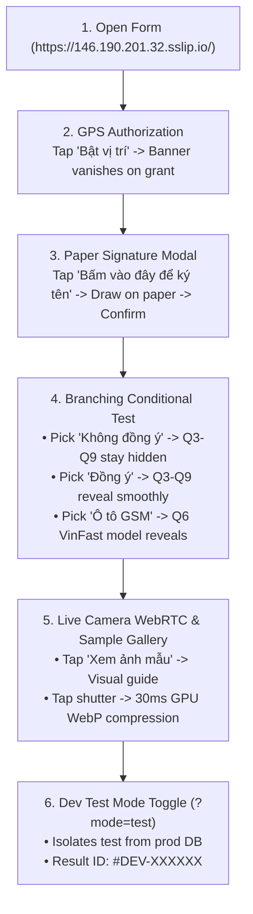

# Master Testing & Component Auditing Guide: Trust Bridge Pipeline
**Document Version:** 1.0 (Production Staging)  
**Target Environment:** DigitalOcean Droplet `146.190.201.32` (`https://146.190.201.32.sslip.io`)  
**Audience:** QA Engineers, Technical Stakeholders, and Lead Developers

---

## 1. End-to-End Feature Testing & Demo Walkthrough

Use this section to demo the complete user journey to clients or verify features on your phone:



### Test Case 1: GPS Permission & Clean Auto-Dismiss
- **URL:** `https://146.190.201.32.sslip.io/`
- **Action:** Notice the top banner: `Cho phép truy cập vị trí để xác nhận điểm bàn giao ca`. Tap **`Bật vị trí`**.
- **Expected Result:**
  - Browser displays native location prompt (`Allow while using app`).
  - Button shows temporary `Đang lấy...` status.
  - Upon granting permission, the banner **completely closes and disappears** from the screen with zero clutter.

### Test Case 2: Smooth Paper Signature Modal & Native Scrolling
- **Action:** Look at Question 1: *1. Chữ ký tài xế*. Tap **`Bấm vào đây để ký tên trên giấy`**.
- **Expected Result:**
  - A realistic white parchment paper modal sheet pops up over the screen.
  - Draw your signature with your finger above the dashed signature baseline.
  - Tap **`Hoàn tất chữ ký`**.
  - The modal closes, the signature appears neatly in the preview card, and **the entire webpage resumes 100% native, butter-smooth vertical scrolling with zero address bar jumping**.

### Test Case 3: Live Branching Logic (Consent & Vehicle Types)
- **Action A (Negative Branching):**
  - Under Question 2 (*Xác nhận thông tin ca làm việc*), tap **`Tôi không đồng ý`**.
  - **Expected Result:** Questions 3 to 9 remain completely hidden.
- **Action B (Positive Branching):**
  - Tap **`Tôi đồng ý`**.
  - **Expected Result:** Questions 3 to 9 smoothly reveal themselves.
- **Action C (Nested Vehicle Branching):**
  - Under Question 5 (*Loại phương tiện*), tap **`Xe máy điện`** -> Question 6 (*Dòng xe VinFast*) stays hidden.
  - Tap **`Ô tô điện VinFast (GSM)`** -> Question 6 instantly unlocks with dropdown options: `VF 5 Plus`, `VF e34`, `VF 8`...

### Test Case 4: WebRTC Live Camera & Visual Sample Gallery
- **Action A (Visual Sample Gallery):**
  - Under Question 9 (*Ảnh chụp đồng hồ km hoặc ứng dụng*), tap **`Xem ảnh mẫu`**.
  - **Expected Result:** Displays real sample photos of a clear receipt and car odometer with a tap-to-expand link.
- **Action B (Hardware Camera Viewfinder):**
  - Point your phone at any paper text or screen.
  - Tap the green circular shutter button.
  - **Expected Result:** Phone GPU compresses frame to ~50KB WebP in 30ms and displays the preview with a **`Chụp lại`** retake button.

### Test Case 5: Dev Test Mode Isolation (Zero Prod Database Pollution)
- **URL:** `https://146.190.201.32.sslip.io/?mode=test` (or tap **`Bật thử nghiệm`** on the header).
- **Action:** Submit the form with test data.
- **Expected Result:**
  - Submission receives ID prefixed with **`#DEV-XXXXXX`**.
  - Full DeepSeek-Flash AI vision extraction runs live.
  - Submission is stored in temporary dev storage (`data/dev_test_submissions.json`).
  - **Production PostgreSQL tables (`survey_submissions`, `collaborator_billing_ledger`, `driver_registered_vehicles`) are completely untouched!**

---

## 2. Component-by-Component Auditing & Log Viewing Guide

Run these terminal commands (via SSH on `146.190.201.32` or laptop) to inspect the audit trails of every single component in real time:

```bash
# Connect to your server
ssh root@146.190.201.32
cd ~/survey-pipeline
```

---

### Component 1: Production Master Submissions (`survey_submissions` SSOT)
To inspect all master survey records stored in PostgreSQL:
```bash
docker exec -it survey-pipeline-postgres-1 psql -U postgres -d surveydb -c \
  "SELECT submission_id, driver_phone, driver_name, receipt_serial_no, status, rejection_reason, created_at \
   FROM survey_submissions \
   ORDER BY created_at DESC \
   LIMIT 10;"
```

---

### Component 2: The 8-Hop Cryptographic Audit Chain (`system_audit_log`)
To audit every single hop a piece of data makes with its SHA-256 tamper-evident hash (Decree 13 / DPIA Compliance):
```bash
docker exec -it survey-pipeline-postgres-1 psql -U postgres -d surveydb -c \
  "SELECT hop_number, hop_name, component_name, action, entity_type, entity_id, actor_type, tamper_evident_hash \
   FROM system_audit_log \
   ORDER BY event_timestamp DESC \
   LIMIT 15;"
```
*Expected Output:* You will see `HOP_1_INGEST` -> `HOP_2_NORMALIZER` -> `HOP_3_ANTI_FRAUD` -> `HOP_4_AI_VISION` -> `HOP_5_EVALUATOR` -> `HOP_6_TG_NOTIFY` -> `HOP_7_OUTBOX` -> `HOP_8_DOWNSTREAM`.

---

### Component 3: Driver Identity Vault & Decree 13 Data Scrubbing
To audit driver pseudonymization and verify that raw phone numbers are isolated from processing:
```bash
docker exec -it survey-pipeline-postgres-1 psql -U postgres -d surveydb -c \
  "SELECT driver_id, driver_phone, driver_name, is_scrubbed, scrubbed_at, created_at \
   FROM driver_identity_vault \
   ORDER BY created_at DESC \
   LIMIT 10;"
```

---

### Component 4: Decoupled Outbox Event Queue (`outbox_events`)
To monitor asynchronous downstream dispatches (Billing, R2 uploads, Telegram notices, Lark sync):
```bash
docker exec -it survey-pipeline-postgres-1 psql -U postgres -d surveydb -c \
  "SELECT id, event_type, flow_target, aggregate_id, status, retry_count, created_at \
   FROM outbox_events \
   ORDER BY created_at DESC \
   LIMIT 10;"
```

---

### Component 5: Redis 7 Rate Limiter & Webhook Deduplication
To inspect in-memory rate-limiting counters (3 appeals / 8 hours) and active deduplication locks:
```bash
# List active keys
docker exec -it survey-pipeline-redis-1 redis-cli KEYS "*"

# Check remaining appeal quota for a test phone number
docker exec -it survey-pipeline-redis-1 redis-cli GET "rate_limit:appeal:0988123456"

# Check TTL (time-to-live) of an appeal window
docker exec -it survey-pipeline-redis-1 redis-cli TTL "rate_limit:appeal:0988123456"
```

---

### Component 6: Temporary Dev Test Storage Inspection & Reset
To audit test submissions without touching the database:
```bash
# Query dev test submissions via REST API
curl -s https://146.190.201.32.sslip.io/api/v1/dev/submissions | jq .

# View raw JSON storage file on disk
cat ~/survey-pipeline/data/dev_test_submissions.json

# Wipe temporary dev storage clean in 1 second
curl -s -X DELETE https://146.190.201.32.sslip.io/api/v1/dev/submissions | jq .
```

---

### Component 7: Caddy TLS 1.3 & HTTP Access Logs
To view live incoming connections, client IPs, SSL handshake versions, and response codes:
```bash
# Stream live Caddy logs
docker compose logs -f caddy

# Or inspect the internal access log file
docker exec -it survey-pipeline-caddy-1 tail -f /var/log/caddy/access.log
```

---

### Component 8: FastAPI Application & Uvicorn Workers
To monitor real-time AI vision extraction latency, image blur scores, and webhook events:
```bash
# Stream live Uvicorn worker logs
docker compose logs -f app
```
*Look for:* `[AI VISION] DeepSeek responded in 1.42s`, `Laplacian variance: 245.8 (SHARP)`.

---

### Component 9: Ephemeral 36-Hour Telegram Message Deletion Queue
To audit messages scheduled for automated privacy deletion under Decree 13:
```bash
docker exec -it survey-pipeline-postgres-1 psql -U postgres -d surveydb -c \
  "SELECT id, chat_id, message_id, sent_at, delete_after, is_deleted, deleted_at \
   FROM telegram_sent_messages \
   ORDER BY delete_after ASC \
   LIMIT 10;"
```

---

### Component 10: Telegram Chat History Log (Internal Audit Trail)
To inspect two-way driver and admin conversation history stored internally:
```bash
docker exec -it survey-pipeline-postgres-1 psql -U postgres -d surveydb -c \
  "SELECT id, telegram_user_id, role, direction, message_text, is_scrubbed, created_at \
   FROM telegram_chat_history \
   ORDER BY created_at DESC \
   LIMIT 10;"
```

---

## 3. Quick Health Check Command
Run this one-liner to verify the status of every container simultaneously:
```bash
docker compose ps && curl -s -k https://146.190.201.32.sslip.io/health
```
*Expected Output:* All 5 containers in status **`Up`**, followed by `{"status":"healthy","environment":"production"}`.
